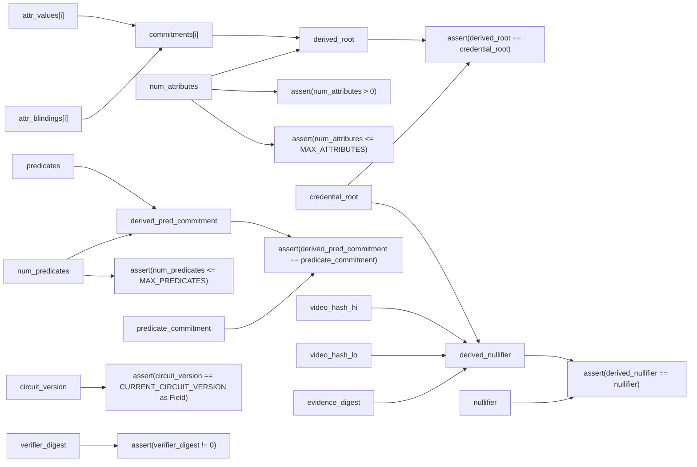
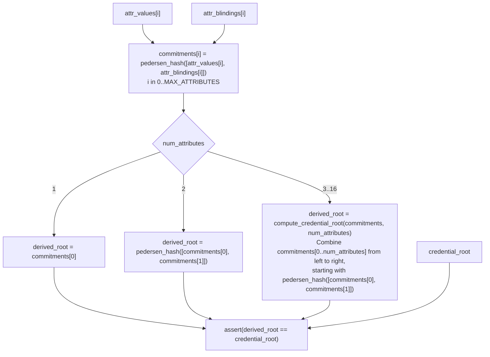
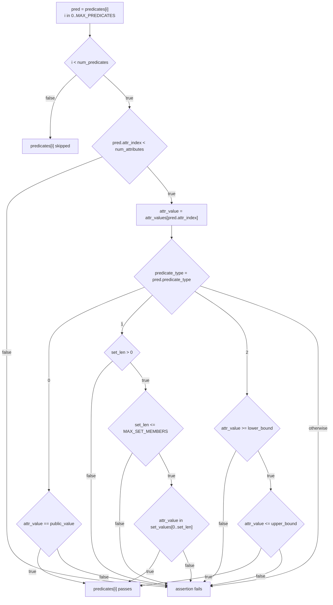
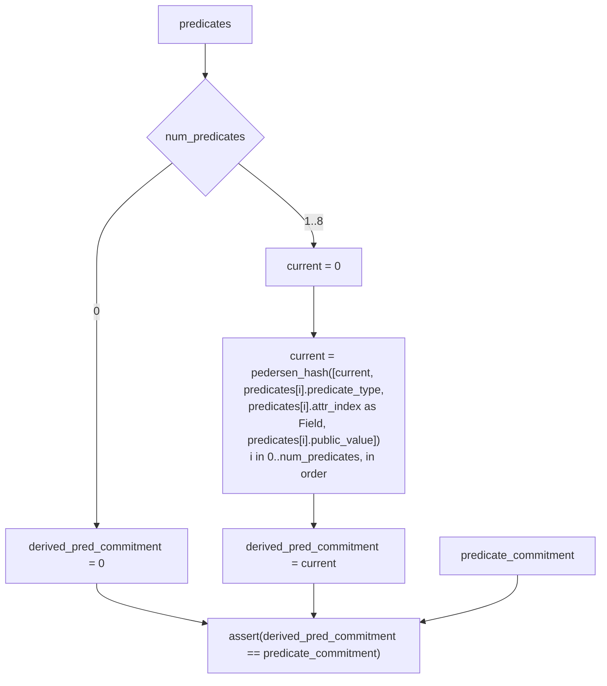
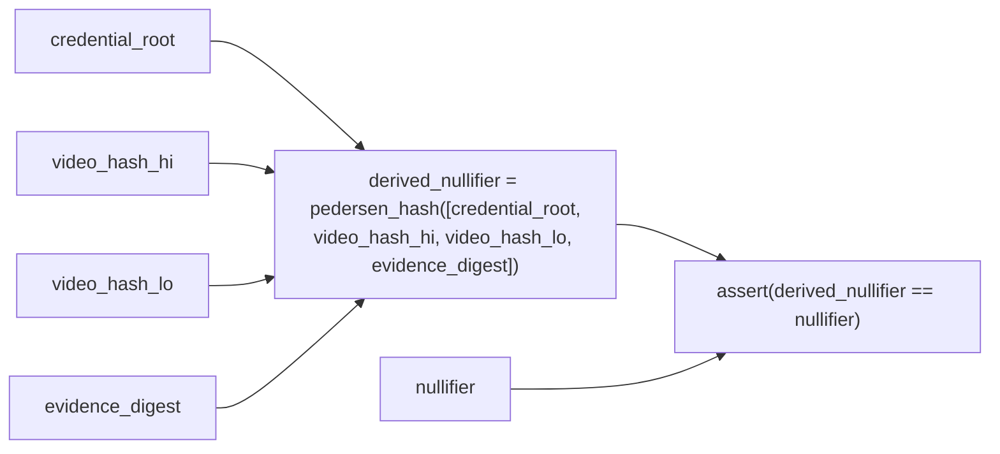
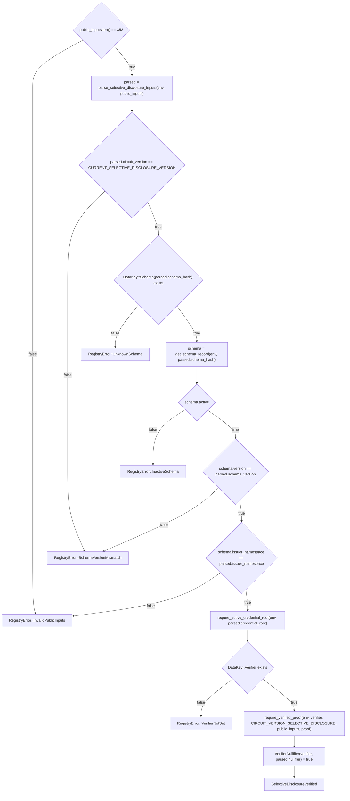
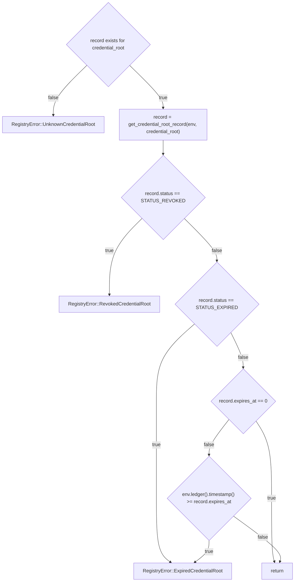

# Selective Disclosure — Circuit Statement and Predicate Encoding

This specification is based on [selective_disclosure/src/main.nr](../zk/noir/selective_disclosure/src/main.nr), the [HarpocratesRegistry implementation](../contracts/contracts/harpocrates-registry/src/lib.rs), the [browser prover](../frontend/src/selectiveDisclosure.ts), and [backend request validation](../backend/schema.py) as of commit [`842dfe5`](https://github.com/harpocrates-stellar/main/tree/842dfe536f4ac8f5d7c5ca3d02b171ad8141469d).

## 1. Summary

The Noir circuit `selective_disclosure` checks equality, set-membership, and range conditions on hidden `attr_values` and matches those values to a public `credential_root`. A caller submits the resulting `proof` and encoded `public_inputs` to `verify_selective_disclosure`, a function on the `HarpocratesRegistry` smart contract. That function checks stored schema and credential records, then calls the configured proof verifier. This specification describes the circuit statement, those contract checks, and an age/country example.

## 2. Inputs and representations

The prover supplies the public inputs and private witness. `credential_root`, `predicate_commitment`, and `nullifier` are supplied inputs that `main` compares with its calculated values. The registry receives `public_inputs` and `proof`; `attr_values`, `attr_blindings`, and `predicates` remain private.

### 2.1 Public inputs and wire order

All eleven parameters are declared `pub Field`. The registry receives their concatenated 32-byte big-endian encodings, totaling 352 bytes.

| Offset | Parameter | Check or use |
| --- | --- | --- |
| `[0,32)` | `schema_hash` | Selects the stored record at `DataKey::Schema(schema_hash)`; see §4. |
| `[32,64)` | `issuer_namespace` | Compared with `schema.issuer_namespace`. |
| `[64,96)` | `schema_version` | Compared with `schema.version`. |
| `[96,128)` | `credential_root` | Compared with `derived_root`. |
| `[128,160)` | `nullifier` | Compared with `derived_nullifier`. |
| `[160,192)` | `video_hash_hi` | Included in `derived_nullifier`. |
| `[192,224)` | `video_hash_lo` | Included in `derived_nullifier`. |
| `[224,256)` | `verifier_digest` | Required to be nonzero. |
| `[256,288)` | `circuit_version` | Compared with `CURRENT_CIRCUIT_VERSION` and `CURRENT_SELECTIVE_DISCLOSURE_VERSION`. |
| `[288,320)` | `evidence_digest` | Included in `derived_nullifier`. |
| `[320,352)` | `predicate_commitment` | Compared with `derived_pred_commitment`. |

Encode each version as a `u32` preceded by 28 zero bytes. `parse_selective_disclosure_inputs` reads the final four bytes of each version slot and reads the other slots as `BytesN<32>`.

### 2.2 Private witness

| Parameter | Type | Use |
| --- | --- | --- |
| `num_attributes` | `u32` | Number of entries from the start of `commitments` used in `derived_root`; `1..=16`. |
| `attr_values` | `[Field; 16]` | Values passed to `attr_commitment` and selected by `predicates[i].attr_index`. |
| `attr_blindings` | `[Field; 16]` | Blindings passed to `attr_commitment`. |
| `num_predicates` | `u32` | Number of entries from the start of `predicates` to check and hash; `0..=8`. |
| `predicates` | `[Predicate; 8]` | Passed to the predicate checks and `compute_predicate_commitment`. |

Arrays have their full declared lengths. The example fills unused entries with zero; `main` permits other padding values.

### 2.3 Predicate structure and encoding

| Member | Type | Use |
| --- | --- | --- |
| `predicate_type` | `Field` | `0` = equality; `1` = set membership; `2` = range. |
| `attr_index` | `u32` | Selects `attr_values[attr_index]`. |
| `public_value` | `Field` | Equality target; included in `compute_predicate_commitment` for every type. |
| `set_values` | `[Field; 8]` | Set-membership candidates. |
| `set_len` | `u32` | Number of entries from the start of `set_values` eligible for a match. |
| `lower_bound` | `Field` | Inclusive range lower bound. |
| `upper_bound` | `Field` | Inclusive range upper bound. |

`public_value` is private because it belongs to `predicates`. Applications supply the numeric encoding of `attr_values`; `age-and-country.json` defines attribute names and indices but leaves country-code encoding to the application.

## 3. Circuit statement

For the supplied public inputs, the prover must supply `num_attributes`, `attr_values`, `attr_blindings`, `num_predicates`, and `predicates` satisfying the following relation. Names and calculations below follow `main.nr`. Section 5.5 records the compiler errors in that source.

### 3.1 Overall relation

Every assertion in this diagram must hold, together with the predicate assertions in §3.3 for each active `predicates[i]`. `MAX_ATTRIBUTES = 16`, `MAX_PREDICATES = 8`, `MAX_SET_MEMBERS = 8`, and `CURRENT_CIRCUIT_VERSION = 1`.



### 3.2 `commitments` and `derived_root`



For three attributes, the ordered combination is `pedersen_hash([pedersen_hash([commitments[0], commitments[1]]), commitments[2]])`. `attr_values` and `attr_blindings` may contain zero.

### 3.3 `predicates[i]` and `verify_predicate`

`main` checks each `predicates[i]` for `i < num_predicates`. Its `attr_index` selects the entry in `attr_values` to check. `main` passes that entry as `attr_value` to `verify_predicate`, along with each predicate field as the same-named parameter. The diagram splits the source assertions into the conditions required on each branch:



For type `1`, `set_found` is true if any of the first `set_len` entries equals `attr_value`; duplicate entries are allowed. For type `2`, the path reaches `predicates[i] passes` only after both bound checks pass.

The source calculates the condition values and uses `is_active`, `is_eq`, `is_set`, and `is_range` to decide which assertions must hold. The graph shows their logical effect. Inactive slots also use `safe_attr_index` to protect array access; the active path above has already checked the index. Section 6 lists the original assertion expressions and their input values.

### 3.4 `derived_pred_commitment`



The same `predicates[0..num_predicates]` are checked in §3.3 and hashed here. `public_value` is hashed for every type. `set_values`, `set_len`, `lower_bound`, and `upper_bound` are outside this calculation. For `num_predicates = 0`, the predicate checks also have no active slots.

### 3.5 `derived_nullifier`



`credential_root` is the value matched by `derived_root` in §3.2. `video_hash_hi`, `video_hash_lo`, and `evidence_digest` enter this calculation as supplied public inputs.

## 4. Schema registration and verification

Section 3 describes checks on the numbers supplied to the Noir circuit. For example, it checks `attr_values[0]` without knowing that the application calls this value "age". The file [age-and-country.json](../backend/schemas/age-and-country.json) supplies that meaning: its `attributes` array assigns `age` to index `0` and `country` to index `1`.

`HarpocratesRegistry`, implemented in [contracts/harpocrates-registry/src/lib.rs](../contracts/contracts/harpocrates-registry/src/lib.rs), stores a `SchemaRecord` for each schema it accepts. Two functions connect these records to the proof: `add_schema` creates a record before a proof is submitted, and `verify_selective_disclosure` reads the record while checking a submitted proof.

### 4.1 Schema hash binding: storing a record and selecting it

The `schema_hash` input is a 32-byte value. The contract uses it as part of the storage key `DataKey::Schema(schema_hash)`. A proof carrying the same `schema_hash` therefore selects the same stored `SchemaRecord`.

To create that record, the contract's administrator calls `add_schema(admin, schema_hash, issuer_namespace, version, attribute_count)`. The supplied `admin` must equal the address stored under `DataKey::Admin`. The contract also calls `require_auth()` on that address, which requires its approval of this invocation; putting the address in the `admin` argument alone is insufficient.

The call stores these values at `DataKey::Schema(schema_hash)`:

| `SchemaRecord` field | Value stored by `add_schema` |
| --- | --- |
| `schema_hash` | The call's `schema_hash`. |
| `issuer_namespace` | The call's `issuer_namespace`. A later proof must carry these same 32 bytes in its public `issuer_namespace` input. |
| `version` | The call's schema `version`. |
| `attribute_count` | The call's `attribute_count`, required to be between `1` and `16`. |
| `active` | `true`. `deprecate_schema` can later set it to `false`. |
| `created_at` | The ledger timestamp when the record is added. |

If `DataKey::Schema(schema_hash)` already contains a record, `add_schema` rejects the call. It therefore cannot replace that record's namespace, version, or attribute count by calling `add_schema` again with the same `schema_hash`.

`add_schema` receives these fields as arguments; it does not read `age-and-country.json` or calculate `schema_hash` from the file. The JSON's attribute names and indices remain in the application. The contract stores only the fields in the table above.

When a proof is submitted, `verify_selective_disclosure` reads the first 32 bytes of `public_inputs` as `parsed.schema_hash`. It uses that value to retrieve `schema` from `DataKey::Schema(parsed.schema_hash)`, then requires `schema.active`, `schema.version == parsed.schema_version`, and `schema.issuer_namespace == parsed.issuer_namespace`. These are the schema-hash checks implemented by this path; §4.3 records the relationships it leaves unchecked.

### 4.2 Checking a submitted proof

A caller invokes `verify_selective_disclosure(public_inputs, proof)` with the eleven encoded public inputs from §2.1 and the proof bytes produced by the proving backend. This function first checks the stored schema record and the stored record for `parsed.credential_root`, then asks the configured verifier contract to check `proof` against `public_inputs`.



`require_active_credential_root` checks whether the submitted `credential_root` has a stored record that is neither revoked nor expired. It retrieves that record as `record`; an `expires_at` value of zero means it has no time-based expiry:



The call to `require_verified_proof` succeeds only if the circuit version is supported, `proof` is nonempty, and the configured verifier accepts `public_inputs` and `proof`. Any failing function call stops `verify_selective_disclosure`. On success, the function stores `VerifierNullifier(verifier, parsed.nullifier) = true` and publishes `SelectiveDisclosureVerified` with `parsed.schema_hash`, `parsed.credential_root`, `parsed.nullifier`, and `parsed.evidence_digest`. It writes the nullifier without first checking whether it is already stored.

### 4.3 Binding limits

The lookups and comparisons in §4.1 check that the submitted `schema_hash`, `schema_version`, and `issuer_namespace` match a stored, active `SchemaRecord`. The following additional relationships are not checked:

| Values | What the source checks |
| --- | --- |
| JSON contents and `schema_hash` | `add_schema` stores the `schema_hash` argument; it does not hash the JSON. |
| `schema_hash` and `credential_root` | `derived_root` hashes `attr_values` and `attr_blindings`; it does not include `schema_hash`. |
| `schema_hash` and `predicate_commitment` / `nullifier` | Neither `derived_pred_commitment` nor `derived_nullifier` includes `schema_hash`. |
| `schema.attribute_count` and `num_attributes` | `add_schema` bounds `attribute_count`, and `main` bounds `num_attributes`; no comparison connects the two. |
| `schema.issuer_namespace` and the stored credential-root record | `verify_selective_disclosure` checks them independently. The credential-root record has no `issuer_namespace` field to compare. |
| `verifier_digest` and `schema_hash` / `circuit_version` | `main` computes `derived_verifier_digest` from these three values but never checks its result. Its only assertion on `verifier_digest` is that it is nonzero. |
| `evidence_digest` and `video_hash_hi` / `video_hash_lo` | All three enter `derived_nullifier` as supplied; `main` does not derive `evidence_digest` from the video-hash components. |
| `video_hash_hi` / `video_hash_lo` and 128-bit values | Both parameters have type `Field`; there is no additional 128-bit bound. |
| `predicate_commitment` and the complete contents of `predicates` | `derived_pred_commitment` omits `set_values`, `set_len`, `lower_bound`, and `upper_bound`. |

For example, the range checks test `lower_bound` and `upper_bound`, but changing those bounds does not change `derived_pred_commitment`. A verifier that expects a particular age range cannot identify that range from `predicate_commitment` alone.

### 4.4 Schema and circuit versions

The two version inputs are checked against different values:

| Submitted input | Required value |
| --- | --- |
| `schema_version` | `schema.version` stored by the earlier `add_schema` call. |
| `circuit_version` | Noir's `CURRENT_CIRCUIT_VERSION` and the contract's `CURRENT_SELECTIVE_DISCLOSURE_VERSION`, both `1`. |

`CIRCUIT_VERSION_SELECTIVE_DISCLOSURE` aliases `CURRENT_SELECTIVE_DISCLOSURE_VERSION` when the contract calls `require_verified_proof`. A matching `schema_version` does not permit a different `circuit_version`.

### 4.5 HTTP submission boundary

`POST /api/verify/selective-disclosure` is the backend HTTP endpoint for submitting these values as hexadecimal strings. It requires `schemaHash` (64 characters), `publicInputs` (704 characters = 352 bytes), and a nonempty `proof`. These lengths exclude a `0x` prefix.

The endpoint checks the request format. Its success response says the submission was accepted and directs the caller to `verify_selective_disclosure` for on-chain verification. The endpoint itself neither calls that contract function nor verifies the proof. It also does not compare the request's `schemaHash` field with the first 32 bytes encoded in `publicInputs`.

## 5. Worked example: age and country

### 5.1 Schema fields used by the example

Use `backend/schemas/age-and-country.json` for the attribute names, indices, count, namespace, and schema version:

```text
attributeCount = 2
attributes     = [{name: "age", index: 0}, {name: "country", index: 1}]
issuerNamespace = 0000000000000000000000000000000000000000000000000000000000000001
version = 1
```

Its checked-in `schemaHash` is `a1b2c3d4e5f6a7b8c9d0e1f2a3b4c5d6e7f8a9b0c1d2e3f4a5b6c7d8e9f0a1b2`. Its numeric value exceeds the BN254 field modulus, so it cannot be passed unchanged as a circuit `Field`. Reducing the value modulo the field modulus would change the registry key.

The example therefore keeps `schema_hash = 0x1234567890abcdef1234567890abcdef1234567890abcdef1234567890abcdef` from `Prover.toml.example`. It uses the `attributes`, `attributeCount`, `issuerNamespace`, and `version` values from the JSON. To submit these inputs to `verify_selective_disclosure`, the contract would first need an `add_schema` record under this exact `schema_hash` and a stored, usable record for the example's `credential_root`.

### 5.2 `attr_values`, `attr_blindings`, and `predicates`

The example checks `18 <= age <= 99` AND `country` in `{12345678, 87654321}`. `age-and-country.json` assigns age to `attr_values[0]` and country to `attr_values[1]`. The country values are synthetic, and `attr_blindings` uses fixed values so the calculations are reproducible. Small numbers below are decimal.

```text
num_attributes = 2
attr_values = [18, 12345678, 0, 0, 0, 0, 0, 0, 0, 0, 0, 0, 0, 0, 0, 0]
attr_blindings = [111111, 222222, 0, 0, 0, 0, 0, 0, 0, 0, 0, 0, 0, 0, 0, 0]
num_predicates = 2

predicates[0] = {
    predicate_type: 2, attr_index: 0, public_value: 0,
    set_values: [0,0,0,0,0,0,0,0], set_len: 0,
    lower_bound: 18, upper_bound: 99
}
predicates[1] = {
    predicate_type: 1, attr_index: 1, public_value: 0,
    set_values: [12345678,87654321,0,0,0,0,0,0], set_len: 2,
    lower_bound: 0, upper_bound: 0
}
predicates[2] through predicates[7] = zero-filled Predicate entries
```

For `predicates[0]`, `main` selects `attr_values[0] = 18`. Inside `verify_predicate`, `is_active = true`, `is_range = true`, and:

```text
valid_attr_index = 0 < 2                         = true
range_lower_valid = attr_value >= lower_bound  = 18 >= 18 = true
range_upper_valid = attr_value <= upper_bound  = 18 <= 99 = true
```

For `predicates[1]`, `main` selects `attr_values[1] = 12345678`. `is_active = true`, `is_set = true`, and:

```text
valid_attr_index = 1 < 2                             = true
set_len_gt_0 = set_len > 0                         = 2 > 0 = true
set_len_valid = set_len <= MAX_SET_MEMBERS          = 2 <= 8 = true
set_values[0] == attr_value AND 0 < set_len         = true
set_found                                          = true
```

For `predicates[2]` through `predicates[7]`, `is_active = false`; these slots do not add predicate requirements or change `derived_pred_commitment`.

### 5.3 `derived_root`, `derived_pred_commitment`, and `derived_nullifier`

Set `video_hash_hi = 1234`, `video_hash_lo = 5678`, `evidence_digest = 9999`, `verifier_digest = 42`, and `circuit_version = 1`. The source calculations become:

```text
commitments[0] = pedersen_hash([18, 111111])
commitments[1] = pedersen_hash([12345678, 222222])
derived_root = pedersen_hash([commitments[0], commitments[1]])

compute_predicate_commitment:
    current = 0
    current = pedersen_hash([current, 2, 0, 0])   # predicates[0]
    current = pedersen_hash([current, 1, 1, 0])   # predicates[1]
    derived_pred_commitment = current

derived_nullifier = pedersen_hash([credential_root, 1234, 5678, 9999])
```

With Nargo `1.0.0-beta.9`, the 32-byte hexadecimal results are:

| Value | Result |
| --- | --- |
| `commitments[0]` | `0x111f43d8bbe3f1eaa7df96129cd2c4b75eb17cb4eb8b77797e2ab24063e4cbde` |
| `commitments[1]` | `0x11fa237c3d36f6e535bcf84b4ed7f1e186eafd2129c345b2cd23e83cc441fe5a` |
| `derived_root` / `credential_root` | `0x0e1abf2892130a047db8d8a8220dce18d59b75f7571693ad890a2eacfc1575bf` |
| `current` after `predicates[0]` | `0x2bfdc67aeb45b53914dd49aa0458253c88e03b7db4885afb3ed87bbee1c004ec` |
| `derived_pred_commitment` / `predicate_commitment` | `0x128eddbdfc9a045e43840dff12b0f6db655f00e69ff0c9664aaac66c59b90484` |
| `derived_nullifier` / `nullifier` | `0x19b6ccfc18895b186ac66b3b658b9aa45549051fd4164538761050f126a94440` |

The other public inputs are the template's `schema_hash`, the JSON's `issuerNamespace` encoded as `issuer_namespace = 1`, and `schema_version = 1`. The assignments above satisfy the count, version, and nonzero checks:

```text
circuit_version == CURRENT_CIRCUIT_VERSION as Field: 1 == 1
verifier_digest != 0:                               42 != 0
num_attributes > 0:                                 2 > 0
num_attributes <= MAX_ATTRIBUTES:                    2 <= 16
num_predicates <= MAX_PREDICATES:                    2 <= 8
derived_root == credential_root:                    same table value
derived_pred_commitment == predicate_commitment:    same table value
derived_nullifier == nullifier:                     same table value
```

The predicate-dependent assertions are evaluated in §5.2. Changing `predicates[0].lower_bound` or `predicates[0].upper_bound` to another range containing `18` leaves `derived_pred_commitment` unchanged. The same applies when the first `predicates[1].set_len` entries of `predicates[1].set_values` are replaced with other values that still include `12345678`.

### 5.4 Reproduce from `Prover.toml.example`

Run the following from the repository root with Python 3.11+ and Nargo 1.0.0-beta.9 on `PATH`; use WSL on Windows. The script fills `Prover.toml.example` using the JSON schema and values above, then writes the completed inputs and a hash-checking helper into a temporary directory. It copies `harpocrates_common` alongside the circuit to preserve the relative dependency path.

```bash
export SD_EXAMPLE_DIR="$(mktemp -d)"
python3 - <<'PY'
import json
import os
from pathlib import Path
import shutil
import tomllib

repo = Path.cwd()
out = Path(os.environ["SD_EXAMPLE_DIR"])
schema = json.loads((repo / "backend/schemas/age-and-country.json").read_text())
assert [(a["name"], a["index"]) for a in schema["attributes"]] == [
    ("age", 0), ("country", 1)
]
assert schema["attributeCount"] == 2

for package in ("selective_disclosure", "harpocrates_common"):
    shutil.copytree(repo / "zk/noir" / package, out / package,
                    ignore=shutil.ignore_patterns("target"))

package = out / "selective_disclosure"
data = tomllib.loads((package / "Prover.toml.example").read_text())
# Keep the template's field-safe demo schema_hash, not the JSON's oversized key.
data.update(
    issuer_namespace="0x" + schema["issuerNamespace"],
    schema_version=str(schema["version"]),
    credential_root="0x0e1abf2892130a047db8d8a8220dce18d59b75f7571693ad890a2eacfc1575bf",
    nullifier="0x19b6ccfc18895b186ac66b3b658b9aa45549051fd4164538761050f126a94440",
    video_hash_hi="1234", video_hash_lo="5678", verifier_digest="42",
    circuit_version="1", evidence_digest="9999",
    predicate_commitment="0x128eddbdfc9a045e43840dff12b0f6db655f00e69ff0c9664aaac66c59b90484",
    num_attributes=str(schema["attributeCount"]),
    attr_values=["18", "12345678"] + ["0"] * 14,
    attr_blindings=["111111", "222222"] + ["0"] * 14,
    num_predicates="2",
)
data["predicates"][0].update(
    predicate_type="2", attr_index="0", public_value="0",
    lower_bound="18", upper_bound="99",
)
data["predicates"][1].update(
    predicate_type="1", attr_index="1",
    set_values=["12345678", "87654321"] + ["0"] * 6, set_len="2",
)

def toml(value):
    if isinstance(value, list):
        return "[" + ", ".join(map(toml, value)) + "]"
    if isinstance(value, dict):
        return "{ " + ", ".join(k + " = " + toml(v) for k, v in value.items()) + " }"
    return json.dumps(value)

text = "\n".join(k + " = " + toml(v) for k, v in data.items()) + "\n"
assert "<" not in text, "unfilled template placeholder"
(package / "Prover.toml").write_text(text)

public_names = [
    "schema_hash", "issuer_namespace", "schema_version", "credential_root",
    "nullifier", "video_hash_hi", "video_hash_lo", "verifier_digest",
    "circuit_version", "evidence_digest", "predicate_commitment",
]
def number(value):
    return int(value, 16) if value.startswith("0x") else int(value)
prime = 21888242871839275222246405745257275088548364400416034343698204186575808495617
assert all(0 <= number(data[k]) < prime for k in public_names)
wire = b"".join(number(data[k]).to_bytes(32, "big") for k in public_names)
assert len(wire) == 352
(package / "public-inputs.hex").write_text(wire.hex() + "\n")

helper = out / "example_hashes"
(helper / "src").mkdir(parents=True)
(helper / "Nargo.toml").write_text(
    '[package]\nname = "example_hashes"\ntype = "bin"\n'
    'authors = ["Harpocrates"]\ncompiler_version = ">=1.0.0"\n[dependencies]\n'
)
hash_names = [
    "attr_values", "attr_blindings", "credential_root", "predicate_commitment",
    "nullifier", "video_hash_hi", "video_hash_lo", "evidence_digest",
]
(helper / "Prover.toml").write_text(
    "\n".join(k + " = " + toml(data[k]) for k in hash_names) + "\n"
)
print(package)
PY

cat > "$SD_EXAMPLE_DIR/example_hashes/src/main.nr" <<'NR'
use std::hash::pedersen_hash;

fn main(
    attr_values: [Field; 16],
    attr_blindings: [Field; 16],
    credential_root: Field,
    predicate_commitment: Field,
    nullifier: Field,
    video_hash_hi: Field,
    video_hash_lo: Field,
    evidence_digest: Field,
) -> pub [Field; 6] {
    let mut commitments: [Field; 16] = [0; 16];
    commitments[0] = pedersen_hash([attr_values[0], attr_blindings[0]]);
    commitments[1] = pedersen_hash([attr_values[1], attr_blindings[1]]);
    let derived_root = pedersen_hash([commitments[0], commitments[1]]);
    let mut current: Field = 0;
    let next = pedersen_hash([current, 2, 0, 0]);
    current = next;
    current = pedersen_hash([current, 1, 1, 0]);
    let derived_pred_commitment = current;
    let derived_nullifier = pedersen_hash([credential_root, video_hash_hi, video_hash_lo, evidence_digest]);
    assert(commitments[0] == 0x111f43d8bbe3f1eaa7df96129cd2c4b75eb17cb4eb8b77797e2ab24063e4cbde);
    assert(commitments[1] == 0x11fa237c3d36f6e535bcf84b4ed7f1e186eafd2129c345b2cd23e83cc441fe5a);
    assert(next == 0x2bfdc67aeb45b53914dd49aa0458253c88e03b7db4885afb3ed87bbee1c004ec);
    assert(derived_root == credential_root);
    assert(derived_pred_commitment == predicate_commitment);
    assert(derived_nullifier == nullifier);
    [commitments[0], commitments[1], derived_root, next, derived_pred_commitment, derived_nullifier]
}
NR

(cd "$SD_EXAMPLE_DIR/example_hashes" && nargo check && nargo execute age_country_hashes)
```

The helper reports `Circuit witness successfully solved` and saves `example_hashes/target/age_country_hashes.gz` after checking the six hash results. The script also produces a padded `selective_disclosure/Prover.toml` and a 704-character `public-inputs.hex`. These checks verify the example's hashes; executing the selective-disclosure circuit requires resolving the compiler errors below.

Nargo may print a field value as a negative number. Add `prime` from the script to that value before comparing its hexadecimal encoding with the table.

### 5.5 Checking the original circuit

Using the same scratch directory, check the copied `selective_disclosure` package:

```bash
(cd "$SD_EXAMPLE_DIR/selective_disclosure" && nargo check)
```

With the pinned compiler it exits nonzero. Relevant diagnostics include:

```text
Call to unconstrained function is unsafe and must be in an unconstrained function or unsafe block
Fields cannot be compared, try casting to an integer first
```

The source declares `eq_predicate_type`, `set_membership_predicate_type`, and `range_predicate_type` as `unconstrained fn`, then calls them from ordinary functions. Nargo rejects those calls because they require an `unsafe` block or an unconstrained calling function.

In `verify_predicate`, `attr_value`, `lower_bound`, and `upper_bound` are all `Field`. The expressions `attr_value >= lower_bound` and `attr_value <= upper_bound` use ordering operators that this compiler rejects for `Field`.

These errors prevent `nargo execute age_country` from producing a witness for the original package. Section 5.4 verifies the example's hash values with a separate helper.

## 6. Assertion-to-input correspondence

The table preserves every `assert` expression in `main` and its predicate-checking functions for comparison with the source. Section 3.3 shows the expanded decision paths. In these expressions, `is_active = i < num_predicates`; `is_eq`, `is_set`, and `is_range` are the comparisons of `predicate_type` with `0`, `1`, and `2`; `check_set = is_active & is_set`.

| Function | Assertion expression | Input dependencies |
| --- | --- | --- |
| `assert_valid_predicate_type` | `!is_active \| (is_eq \| is_set \| is_range)` | `num_predicates`, `predicates[i].predicate_type` |
| `main` | `circuit_version == CURRENT_CIRCUIT_VERSION as Field` | `circuit_version` |
| `main` | `num_attributes > 0` | `num_attributes` |
| `main` | `num_attributes <= MAX_ATTRIBUTES` | `num_attributes` |
| `main` | `num_predicates <= MAX_PREDICATES` | `num_predicates` |
| `main` | `!is_active \| valid_attr_index` | `num_predicates`, `predicates[i].attr_index`, `num_attributes` |
| `main` | `!check_set \| set_len_gt_0` | `num_predicates`, `predicates[i].predicate_type`, `predicates[i].set_len` |
| `main` | `!check_set \| set_len_valid` | `num_predicates`, `predicates[i].predicate_type`, `predicates[i].set_len` |
| `main` | `derived_root == credential_root` | `num_attributes`, `attr_values`, `attr_blindings`, `credential_root` |
| `verify_predicate` | `!is_active \| (is_eq \| is_set \| is_range)` | `num_predicates`, `predicates[i].predicate_type` |
| `verify_predicate` | `!(is_active & is_eq) \| eq_valid` | `num_predicates`, `predicates[i].predicate_type`, `predicates[i].attr_index`, `attr_values`, `predicates[i].public_value` |
| `verify_predicate` | `!(is_active & is_set) \| set_found` | `num_predicates`, `predicates[i].predicate_type`, `predicates[i].attr_index`, `attr_values`, `predicates[i].set_values`, `predicates[i].set_len` |
| `verify_predicate` | `!(is_active & is_range) \| range_lower_valid` | `num_predicates`, `predicates[i].predicate_type`, `predicates[i].attr_index`, `attr_values`, `predicates[i].lower_bound` |
| `verify_predicate` | `!(is_active & is_range) \| range_upper_valid` | `num_predicates`, `predicates[i].predicate_type`, `predicates[i].attr_index`, `attr_values`, `predicates[i].upper_bound` |
| `main` | `derived_pred_commitment == predicate_commitment` | `num_predicates`, active `predicates[i].predicate_type`, `predicates[i].attr_index`, `predicates[i].public_value`, `predicate_commitment` |
| `main` | `derived_nullifier == nullifier` | `credential_root`, `video_hash_hi`, `video_hash_lo`, `evidence_digest`, `nullifier` |
| `main` | `verifier_digest != 0` | `verifier_digest` |

Section 5.4 reproduces the example's hash values; §5.5 reproduces the original circuit's compiler errors.
